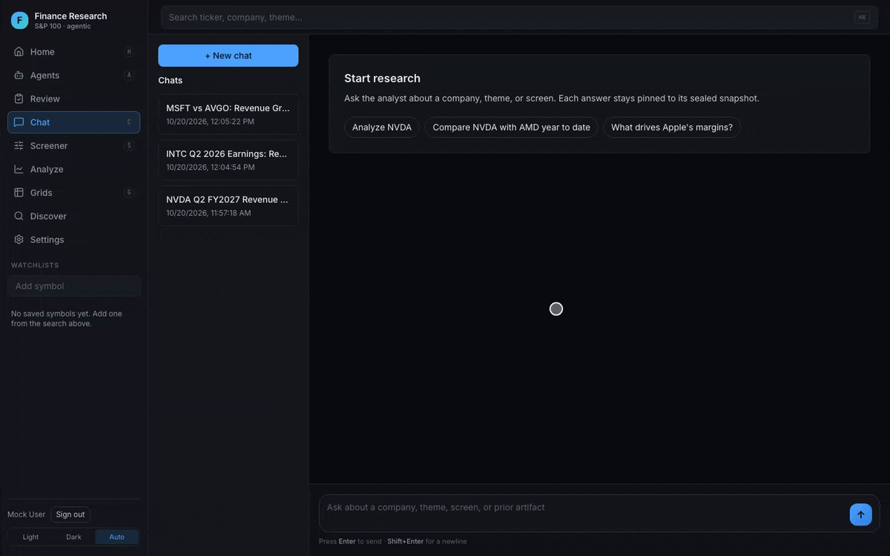
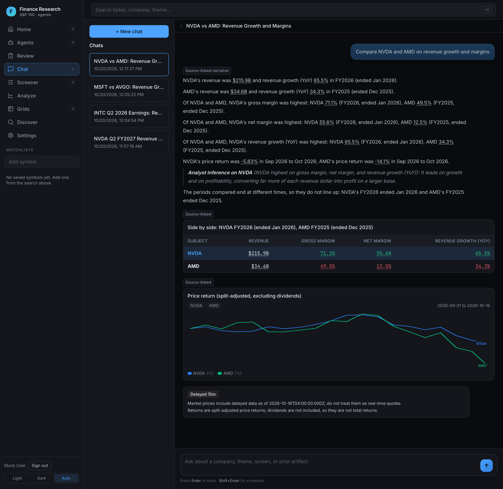
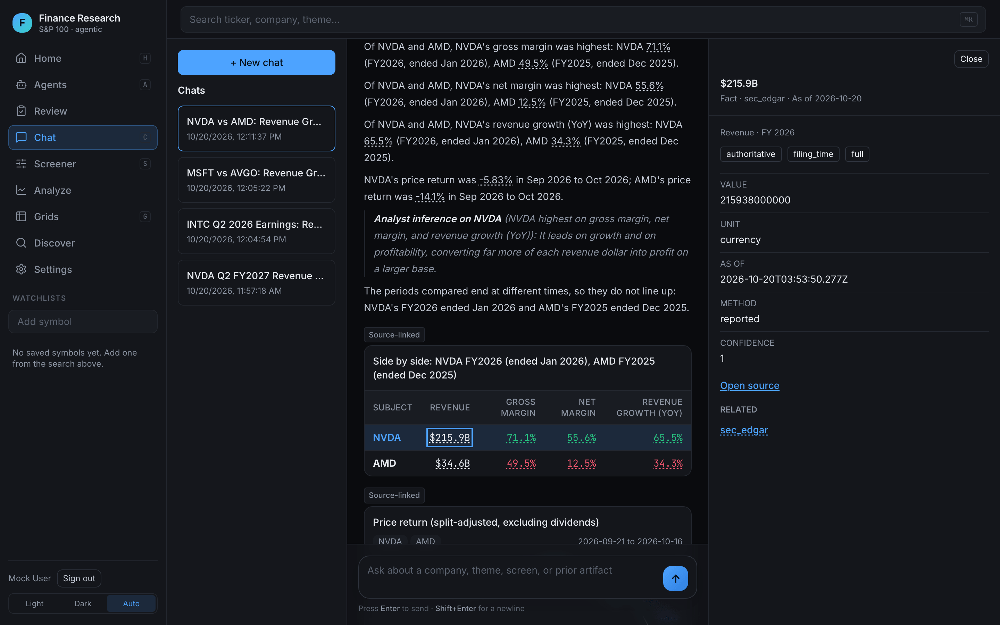
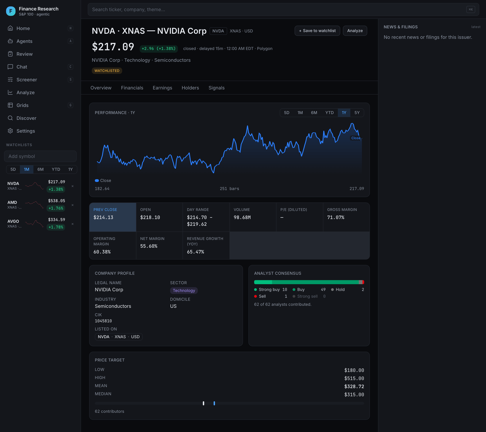
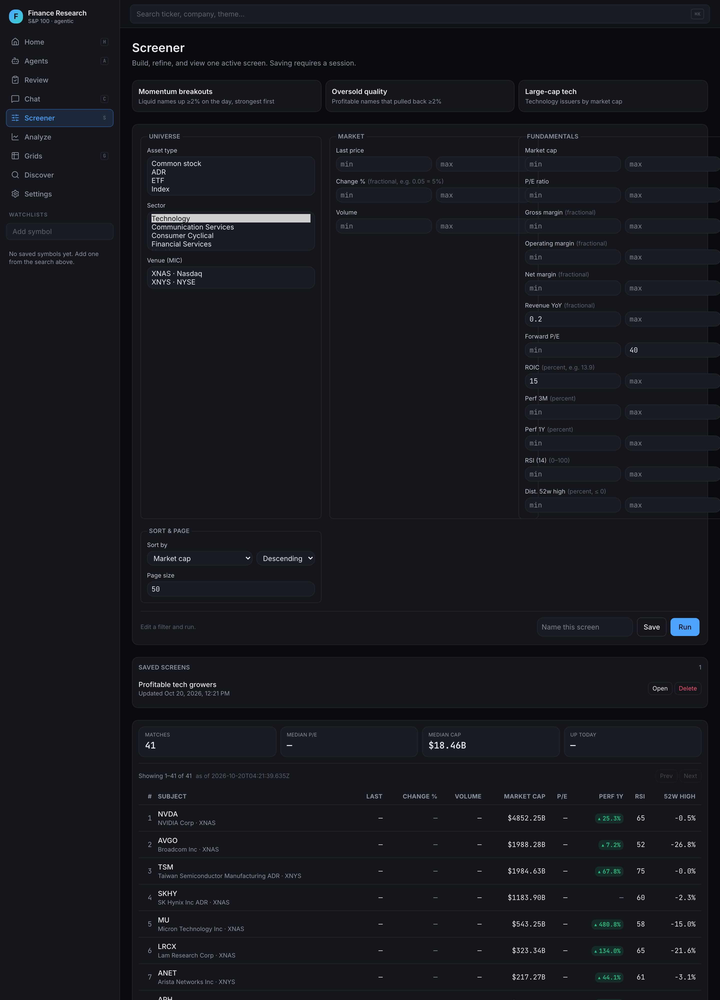
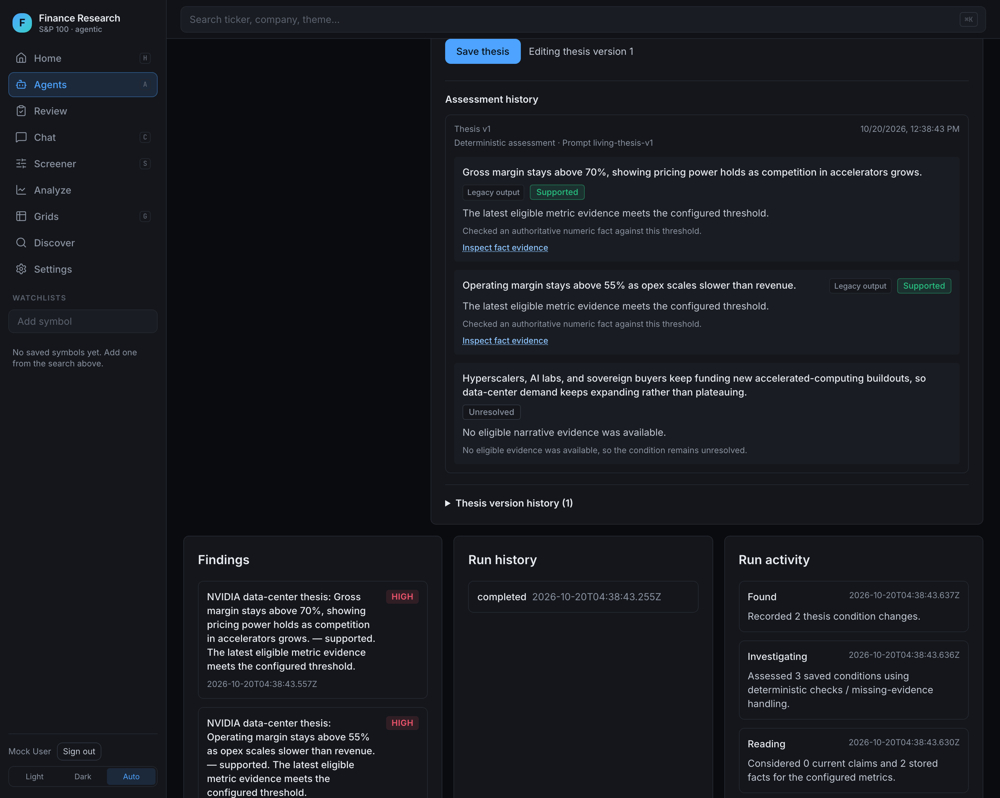

<h1 align="center">market-agent</h1>

<p align="center">
  <b>An AI stock analyst that cites every number.</b><br>
  Ask about any US company. Get charts, tables, and analysis built from SEC filings and market data, with each figure traced to its source.
</p>

<p align="center">
  <a href="https://github.com/xang1234/market-agent/actions/workflows/ci.yml"></a>
  
  
  
  
</p>

<p align="center">
  
</p>

Ask a general-purpose chatbot for a company's gross margin and you get a confident number with no way to check it. market-agent answers only from facts it has stored: SEC company facts, filing extracts, and Polygon prices. Code, not the model, builds the charts and tables. The model writes the narrative, and every figure in it comes from a stored fact you can open. A second model checks each inference before you see it.

## Quickstart

Try the analyst offline first. This needs Node 22.19 or later and npm. No Docker, no API keys.

```bash
git clone https://github.com/xang1234/market-agent.git
cd market-agent
cp .env.dev.example .env.dev
DEV_PROFILE=chat DEV_MODE=ui ./scripts/dev-shell.sh up
```

Open <http://localhost:5173>. Dev mode signs you in as a mock user. Go to **Chat**, start a thread, and ask these word for word: *Analyze NVDA*, then *Compare it with AMD YTD*, then *Explain the differences and show the evidence*. This mode replays a recorded conversation, so other questions and most other pages have no data.

### Run it on live data

The full stack needs Docker for Postgres and MinIO. Add your keys to `.env.dev`, then start it:

```bash
# in .env.dev
POLYGON_API_KEY=...                                 # tickers, quotes, and bars
SEC_EDGAR_USER_AGENT="market-agent you@example.com" # SEC fundamentals
LLM_CHANNELS=anthropic                              # or any OpenAI-compatible endpoint
LLM_ANTHROPIC_PROTOCOL=anthropic
LLM_ANTHROPIC_API_KEY=...
LLM_ANTHROPIC_MODELS=claude-sonnet-5-5,claude-haiku-5-5
LITELLM_MODEL=anthropic/claude-sonnet-5-5
JUDGE_LITELLM_MODEL=anthropic/claude-haiku-5-5
```

```bash
./scripts/dev-shell.sh up   # installs packages, migrates, seeds, and starts the services
```

Chat answers only from facts already stored. Open a company's symbol page once, on the **Financials** tab, to fetch its SEC facts before you ask about it.

[Configuration](docs/configuration.md) lists every key and model setting. [Development](docs/development.md) covers the other dev modes and tests.

## What you can do

<table>
  <tr>
    <td width="50%"></td>
    <td width="50%"></td>
  </tr>
  <tr>
    <td><b>Chat with an analyst.</b> Answers arrive as charts, tables, and metric rows with citations. Threads persist.</td>
    <td><b>Check the numbers.</b> Click a figure to see its source document and how it was computed. Every block is labelled verified, source-linked, or not verified.</td>
  </tr>
  <tr>
    <td></td>
    <td></td>
  </tr>
  <tr>
    <td><b>Research a company.</b> Overview, financials, earnings, holders, and signals on one page.</td>
    <td><b>Screen the market.</b> Filter by price, volume, margins, P/E, and growth. Save a screen and reuse it as a universe for agents and grids.</td>
  </tr>
  <tr>
    <td></td>
    <td></td>
  </tr>
  <tr>
    <td><b>Write a memo.</b> Earnings quality, variant view, peer comparison, or a full investment memo, with the evidence behind it.</td>
    <td><b>Watch a thesis.</b> Agents check your thesis conditions on a schedule and mark each one supported, challenged, or unresolved.</td>
  </tr>
  <tr>
    <td></td>
    <td valign="top"><b>Compare companies in a grid.</b> Put companies in rows and metrics or a research question in columns. A question column has the model read each company's documents.<br><br>The <a href="docs/guide.md">user guide</a> covers every page, including Home, watchlists, the review queue, and Settings.</td>
  </tr>
</table>

## How it works

1. The resolver turns each company you name into a canonical id. An ambiguous name gets a clarifying question, not a guess.
2. Code builds the charts, tables, and metric rows from stored facts. The analyst does not browse the web.
3. The model writes its narrative as structured assertions. A check rejects any assertion the facts do not support, and every figure in the prose comes from a template filled with a stored value.
4. The app seals a snapshot of every fact the answer used and checks each one against the logged tool calls. That snapshot is what the evidence inspector shows.
5. A judge model checks each inference against the facts it rests on. An inference appears only once the judge accepts it.

Set `CHAT_FINANCIAL_MODE=enforce` and questions that name a metric run through the financial engine, which computes with exact fractions and shows anything it cannot verify as a gap. Other questions still use the standard path until [#398](https://github.com/xang1234/market-agent/issues/398) lands. [Architecture](docs/architecture.md) has the full flow and the service map.

## Documentation

| Guide | For |
|---|---|
| [User guide](docs/guide.md) | Every page in the app |
| [Configuration](docs/configuration.md) | API keys, models, data sources, and the financial engine |
| [Development](docs/development.md) | Dev modes, the golden conversation, and tests |
| [Architecture](docs/architecture.md) | How an answer is built, and what each service owns |
| [Discovery campaigns](docs/discovery-campaigns-operations.md) | Rolling out discovery campaigns safely |
| [Design decisions](docs/adr/) | Architecture decision records |

## Roadmap

- [ ] Route every company question through the verified financial engine ([#398](https://github.com/xang1234/market-agent/issues/398))
- [ ] Live business-segment revenue in cited chat breakdowns ([#196](https://github.com/xang1234/market-agent/issues/196))
- [ ] Valuation scenarios with explicit P/E assumptions and dated analyst estimates ([#201](https://github.com/xang1234/market-agent/issues/201), [#224](https://github.com/xang1234/market-agent/issues/224), [#225](https://github.com/xang1234/market-agent/issues/225))
- [ ] Comparisons that disclose their basis, peers, and exclusions ([#209](https://github.com/xang1234/market-agent/issues/209)), and checked gap comparisons ([#288](https://github.com/xang1234/market-agent/issues/288))
- [ ] A wider research-quality eval beyond NVDA, AMD, and AAPL, with a blinded review ([#283](https://github.com/xang1234/market-agent/issues/283), [#222](https://github.com/xang1234/market-agent/issues/222))
- [ ] Discovery campaigns through their release review ([rollout plan](docs/discovery-campaigns-operations.md))
- [ ] An open-source license ([#284](https://github.com/xang1234/market-agent/issues/284))

The two epics, [#190](https://github.com/xang1234/market-agent/issues/190) and [#205](https://github.com/xang1234/market-agent/issues/205), track the rest.

## Contributing

Issues and pull requests are welcome. Work is tracked in [GitHub Issues](https://github.com/xang1234/market-agent/issues). Start with [Development](docs/development.md). If you use a coding agent, point it at [`AGENTS.md`](AGENTS.md).

## Disclaimer

market-agent is a research tool. It is not financial advice and it does not place trades. Check the sources before you act on anything it shows you.
