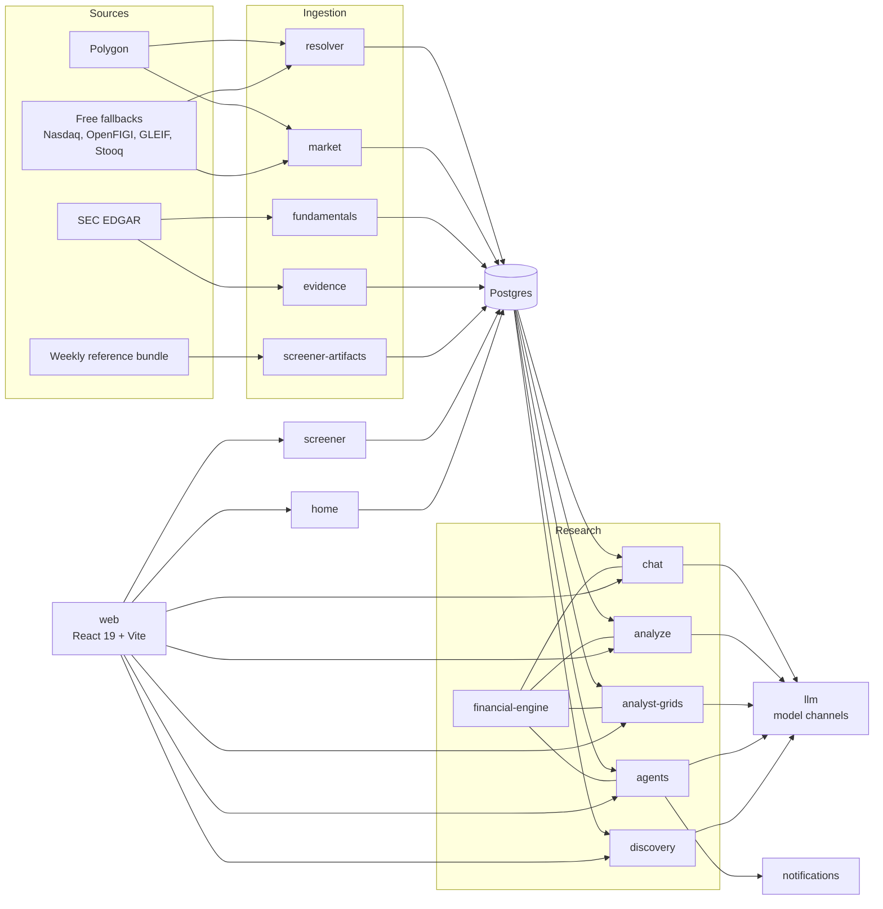

# Architecture

market-agent is a TypeScript monorepo: a React 19 web app, 28 service packages under `services/`, Postgres 15, and MinIO for raw document blobs. Each service has its own `package.json` and test suite. In development, `scripts/dev-shell.sh` runs them all.

## How a chat answer is built

Chat answers from stored facts, not from the web or the model's memory. A chat turn works like this:

1. The resolver turns each company in the question into a canonical `SubjectRef`, a typed UUID. An ambiguous name becomes a clarifying question instead of a guess.
2. Chat reads only facts already stored in Postgres: SEC company facts, Polygon prices, and extracted filing claims. A live check warms a company first, through the same ingestion path the app uses.
3. The model answers in typed blocks (charts, tables, metric rows, and prose) that cite facts by id. The web app renders blocks, never raw Markdown.
4. A separate judge model checks each analyst inference against the facts it rests on. Chat shows an inference only after the judge finds it entailed.
5. The snapshot service stages a manifest of every fact, claim, document, and series the answer used. It checks each one against the logged tool-call results, adds required disclosures such as delayed pricing or low coverage, and seals the manifest. Chat saves the message only after the seal succeeds.
6. In the browser, clicking a figure opens the evidence inspector on that figure's sealed provenance.

When a surface runs the financial engine in `enforce` mode, its calculations (margins, growth, ratios, thresholds) come from `services/financial-engine`. The engine binds a typed plan to stored facts and computes with exact fractions in `services/financial-core`. Anything it cannot verify appears as a named gap. See [Configuration](configuration.md#verified-financial-answers).

## Services

| Service | Owns |
|---|---|
| `web` | The React app |
| `app` | One process that serves the web app and the chat-profile services, and replays recorded traffic in UI mode |
| `dev-api` | The local backend-for-frontend: auth, settings, Analyze, and Agents routes |
| `resolver` | Identity: issuers, instruments, listings, and themes |
| `market` | Quotes, bars, and adjusted price series |
| `fundamentals` | SEC company-facts ingestion and statement normalization |
| `evidence` | Documents, claims, events, facts, and XBRL and non-GAAP extraction |
| `screener` | Filter and rank queries over the universe |
| `screener-artifacts` | Import of the weekly reference bundle into Postgres |
| `chat` | Thread storage, the per-thread turn coordinator, and the SSE stream |
| `tools` | The analyst's tools, their budgets, and approval checks |
| `llm` | Model channels, fallbacks, and the Settings-page config file |
| `snapshot` | Evidence manifest staging, verification, and disclosures |
| `financial-core` | Pure financial semantics: plan schemas, exact arithmetic, and the metric catalog |
| `financial-engine` | Planning, input binding, execution, and recovery of verified calculations |
| `analyze` | Analyze memo playbooks |
| `analyst-grids` | Company-by-column research grids, including model-read document columns |
| `agents` | Agent CRUD, scheduling, thesis assessment, and alert rules |
| `notifications` | Delivery of fired alerts |
| `discovery` | Discovery campaigns, behind `DISCOVERY_ENABLED` |
| `home` | The findings feed, market pulse, and agent summaries |
| `watchlists`, `portfolio`, `themes` | User lists, research holdings, and theme membership |
| `artifact`, `summary`, `observability`, `shared` | Shared libraries: add-to-chat artifacts, titles and headlines, run logs, and HTTP helpers |
| `dev-providers` | An optional yfinance fallback for local development (Python) |

## Further reading

- [`docs/adr/`](adr/) holds the design decisions, such as [session coordinator hosting](adr/0004-session-coordinator-hosting.md) and the [filing extraction boundary](adr/0003-filing-extraction-boundary.md).
- [`CONTEXT.md`](../CONTEXT.md) defines the domain terms.
- [`docs/engineering/`](engineering/) holds working notes and the research-quality eval.
- [`spec/`](../spec/) holds the JSON schemas for financial plans and results.
