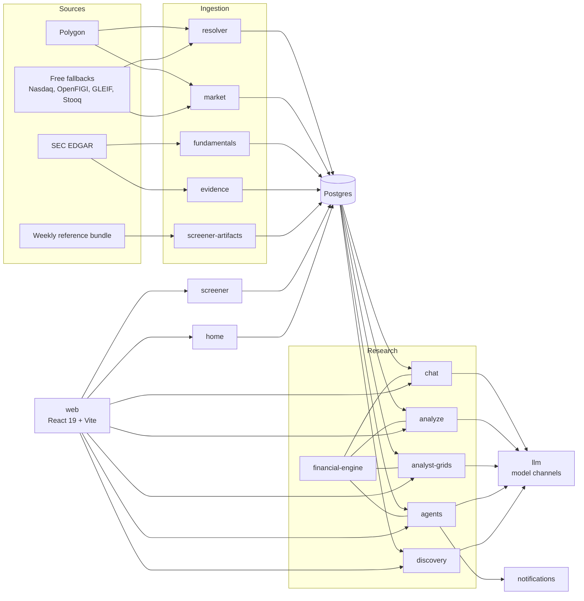

# Architecture

market-agent is a TypeScript monorepo: a React 19 web app, 27 Node packages and one Python package under `services/`, Postgres 15, and MinIO for raw document blobs. Each Node package has its own `package.json` and test suite. In development, `scripts/dev-shell.sh` runs the web app and 11 of these packages as HTTP processes, plus `dev-providers` and the discovery worker when they are turned on. Analyze, Agents, and themes run inside dev-api. The rest are libraries or command-line tools.

## How a chat answer is built

Chat answers from stored facts, not from the web or the model's memory. A chat turn works like this:

1. The resolver turns each company in the question into a canonical `SubjectRef`, a typed UUID. An ambiguous name becomes a clarifying question instead of a guess.
2. Chat reads only facts already stored in Postgres: SEC company facts, Polygon prices, and extracted filing claims. It fetches year-to-date price bars on demand. SEC facts are stored when a symbol page first reads them.
3. The financial engine computes every figure the answer shows from those facts, and certifies each result (#398). One router (`routeTurn`, `services/chat/src/scope-figures.ts`) chooses each turn's plan from its reading and its resolved scope. A follow-up that names no figure of its own is planned with no model at a fiscal year, a quarter or the latest: an overview, a margin trend, or the figures its scope keeps. A period no fiscal field holds, a valuation at a fiscal period, or kept figures with peers are a declared gap instead, and a question that names a figure goes to the model planner. The analyst path answers guidance, evidence and explanation questions from claims. A number appears in its answer only inside a quoted claim, cited to the claim's document, or on a comparison's year-to-date price chart, which is source-linked to stored prices and not verified by the engine until it can state a price return.
4. The model writes the narrative as structured assertions. A check rejects any assertion whose references, bindings, or comparison results do not match the evidence. The accepted ones render through fixed templates, so every figure in the prose is a value from the evidence, never the model's wording. The model's own words survive only inside a labelled inference.
5. The snapshot service stages a manifest of every fact, claim, document, and series the answer used. It checks each one against the logged tool-call results, adds required disclosures such as delayed pricing or low coverage, and seals the manifest. Chat then shows the answer. When a judge is configured, a placeholder marks each inference while the judge reads it.
6. When `JUDGE_LITELLM_MODEL` is set, a separate judge model checks each inference against the observations it rests on, the rest of the answer, and every figure in its evidence (a chart by each line's last value). An inference the judge finds entailed appears as an analyst inference. One that goes beyond the figures without contradicting them appears labelled as an unverified analyst view. An inference a check rejects for its own words or citations, or that the judge finds contradicted or stating an amount in words, goes back once to the answer model with the reason. One left out for the answer's assertion limit or to keep a comparison from reading one-sided does not go back. Its rewrite goes through the same checks and judge, and shows by the same rules. An inference the judge finds stating an amount in words is hidden in an analyst answer, whatever its verdict. In the commentary on an engine answer, one it finds entailed or unsupported shows as an unverified analyst view. Either still goes back once, and the rewrite may show it clean. A failed or late repair leaves an inference as it was: hidden, or an unverified view. There is exactly one round. An inference with a failed or late verdict stays hidden. With no judge, chat shows no inferences.
7. Chat saves the message after the seal, the judge and the repair round are done.
8. The web app renders blocks, never raw Markdown. A block that makes a claim about its values is labelled verified, source-linked, or not verified. Figures are linked to their fact or price series where one can be sealed. Clicking a linked figure opens the evidence inspector on its sealed provenance.

When a surface runs on the financial engine, its calculations (margins, growth, ratios, thresholds) come from `services/financial-engine`. The engine binds a typed plan to stored facts and computes with exact fractions in `services/financial-core`. Anything it cannot verify appears as a named gap. In chat it computes every figure an answer shows, and step 3 says which turns it plans. See [Configuration](configuration.md#verified-financial-answers).

## Services

| Service | Owns |
|---|---|
| `web` | The React app |
| `app` | One process that serves the web app and the chat-profile services, and replays recorded traffic in UI mode |
| `dev-api` | The local backend-for-frontend: auth, settings, themes, the evidence inspector, and the Analyze and Agents routes |
| `resolver` | Identity: issuers, instruments, listings, and themes |
| `market` | Quotes, bars, and adjusted price series |
| `fundamentals` | SEC company-facts ingestion and statement normalization |
| `evidence` | Documents, claims, events, facts, XBRL and non-GAAP extraction, and the fact review queue |
| `screener` | Filter and rank queries over the universe |
| `screener-artifacts` | Import of the weekly reference bundle into Postgres |
| `chat` | Thread storage, the per-thread turn coordinator, the SSE stream, the answer builder, and the inference judge |
| `tools` | The analyst's tools, their budgets, and approval checks |
| `llm` | Model channels, fallbacks, and the Settings-page config file |
| `snapshot` | Evidence manifest staging, verification, and disclosures |
| `financial-core` | Pure financial semantics: plan schemas, exact arithmetic, and the metric catalog |
| `financial-engine` | Planning, input binding, execution, and recovery of verified calculations |
| `analyze` | Analyze memo playbooks |
| `analyst-grids` | Company-by-column research grids, including model-read document columns |
| `agents` | Agent CRUD, scheduling, thesis assessment, and alert rules |
| `notifications` | Delivery of fired alerts |
| `discovery` | Discovery campaigns, behind `DISCOVERY_ENABLED` |
| `home` | The findings feed, market pulse, and agent summaries |
| `watchlists`, `portfolio`, `themes` | User lists, research holdings, and theme membership |
| `artifact`, `summary`, `observability`, `shared` | Shared libraries: add-to-chat artifacts, titles and headlines, run logs, and HTTP helpers |
| `dev-providers` | An optional yfinance and Finviz fallback for local development (Python) |

## Repository layout

| Path | Holds |
|---|---|
| `web/` | The React app and its Playwright tests in `web/e2e/` |
| `services/` | The packages in the table above |
| `db/` | The schema pack, migrations, and seeds |
| `spec/` | The product spec, the database schema, the OpenAPI contract, the block schema, the tool registry, and the financial plan and result schemas |
| `scripts/` | `dev-shell.sh`, the research-quality eval, and repo-wide contract tests |
| `docker-compose.dev.yml` | Postgres 15 and MinIO for development |
| `.env.dev.example` | The main settings, with comments |

## Further reading

- [`docs/adr/`](adr/) holds the design decisions, such as [session coordinator hosting](adr/0004-session-coordinator-hosting.md) and the [filing extraction boundary](adr/0003-filing-extraction-boundary.md).
- [`CONTEXT.md`](../CONTEXT.md) defines the domain terms.
- [`docs/engineering/`](engineering/) holds working notes and the research-quality eval.
